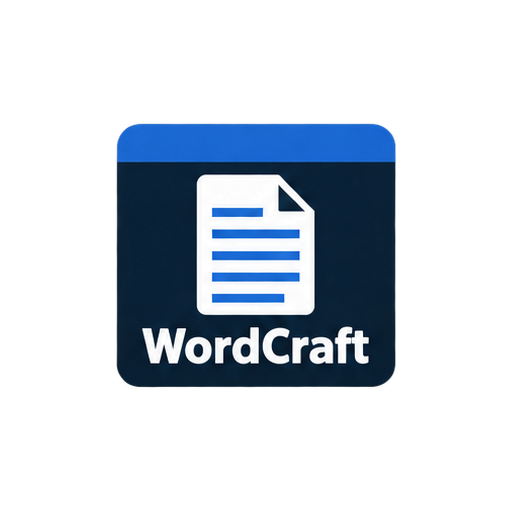

# WordCraft custom desktop icon



Original AI-assisted artwork commissioned by @timsamart, generated with OpenAI's built-in imagegen tool on 2026-10-09. Approved design: a restrained tile, familiar tool symbol and full app name. Source prompt: `generation-prompt.txt`. The full 14-app sheet and reproducible extraction script are in the [ArtCraft fork](https://github.com/timsamart/artcraft/tree/craft-icons-v2/custom-icons/suite).

The PNG is 512x512 RGBA. The Windows ICO contains 16, 24, 32, 48, 64, 128 and 256px images. Both were extracted from one generated sheet and resized with Pillow. Artwork and helper script are offered under MIT; see `LICENSE.txt`. App names identify the corresponding projects; this is an independent custom icon set.

To update an existing Windows Start shortcut, keep this folder in a permanent location and run:

```powershell
powershell -ExecutionPolicy Bypass -File .\custom-icons\apply-icon.ps1
```

The script changes shortcut icons and preserves their executable targets. These assets do not change the icons embedded in application executables or running windows. Applications can be installed independently of this customization.

Validation: PNG alpha and dimensions, all seven ICO sizes, and file hashes checked. No Rust or application behavior is changed.
